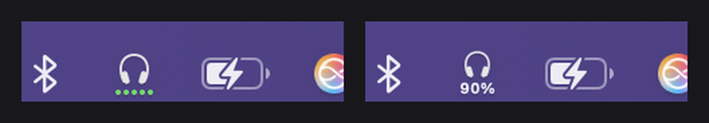
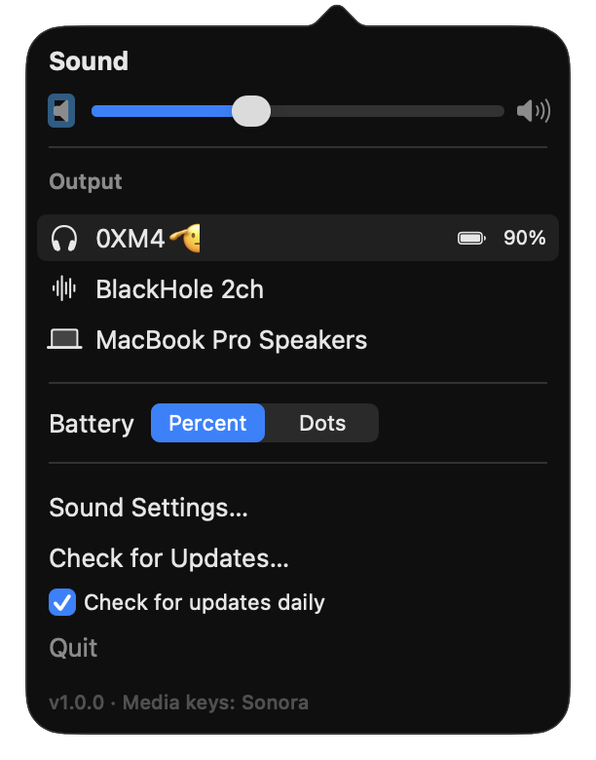

<h1 align="center">Sonora — HeadsetCompanion</h1>

<p align="center">
  <b>Your headset's battery, in the macOS menu bar. Any brand. No account, no cloud, no telemetry.</b><br>
  <sub>A 500 KB menu-bar app that also replaces Apple's Sound menu — and feeds the Sonora Chrome extension.</sub>
</p>

<p align="center">
  <a href="https://github.com/YamineRL/sonora/releases/latest"></a>
  
  
</p>

<p align="center">
  
</p>

---

## The problem

macOS knows your headset's battery level. It just refuses to *show* it anywhere
you'll actually look: you have to open the Bluetooth menu, hover the device, and
read it in a submenu. Meanwhile the number you do see is often **stale** —
macOS keeps showing the level from the last time your headset volunteered one,
which can be hours old.

And if you live in the browser, there's no help there either: Chrome on macOS
has **no Web Bluetooth for classic headsets**, and **no browser API exposes
headset battery at all**.

## What HeadsetCompanion does

| | |
|---|---|
| **Battery at a glance** | Five green dots, or a tiny percentage, right under a headphones glyph. One menu-bar slot — narrower than the clock. |
| **Actually current** | Re-reads the level from a fresh process every 10 s, which is the only way to dodge the per-process cache that makes other tools (and macOS itself) report yesterday's number. |
| **Any headset** | Sony, Bose, AirPods, Jabra, Anker, the €19 pair from the airport. Nothing in the app names a model: it reads whatever the system Bluetooth stack reports, with a BLE Battery Service fallback. |
| **Replaces the Sound menu** | Volume slider, every output device, and each headset's battery on its own row. One click instead of Control Centre → Sound → hover. |
| **Follows what you're listening on** | Switch output to another headset and the menu bar switches with it, within the same second. |
| **Feeds the browser** | Serves `GET http://127.0.0.1:8745/battery` on loopback so the [Sonora Chrome extension](#the-sonora-chrome-extension) can show the same number next to your tabs. |
| **Media keys that behave** | Optionally claims the play/pause keys so your headset's buttons control the tab you mean, not whatever Chrome last touched. |

<p align="center">
  
</p>

## Install

1. **[Download the latest `.dmg`](https://github.com/YamineRL/sonora/releases/latest)**
2. Drag **HeadsetCompanion** into **Applications**.
3. First launch only: **right-click the app → Open → Open**. The app is not
   notarised by Apple (it's free and unsigned), so Gatekeeper asks once.
4. Optional — start it at login:
   ```bash
   /Applications/HeadsetCompanion.app/Contents/Resources/install-launch-agent.sh
   ```
   or add it under **System Settings → General → Login Items**.

That's the last time you download anything by hand.

### Updates take care of themselves

The app checks GitHub Releases **once a day** and installs a newer version in
place, then relaunches — no prompts, no installer, no admin password.

Prefer to decide yourself? Untick **Check for updates daily** in the menu and
use **Check for Updates…** whenever you like. Both paths download the same
signed-by-nobody, verified-by-you DMG from this repository's Releases page,
and nothing is ever sent anywhere: the update check is a single unauthenticated
`GET` to `api.github.com`.

## The Sonora Chrome extension

HeadsetCompanion is the free, open-source half of **Sonora**. The other half is
the **Sonora media cockpit** — a Chrome extension that finds every audible tab
(YouTube, podcasts, web radio) and gives you one set of controls for all of
them, with your headset battery on the same card.

👉 **[Get Sonora on the Chrome Web Store — $5](https://chromewebstore.google.com/)** *(listing link lands here at launch)*

The extension works on its own; the bridge is what adds the battery. Neither
one phones home.

## Privacy

- No network access except **one call to `api.github.com`** to look for updates
  (which you can switch off), and the DMG download when there is one.
- The battery HTTP server binds to **`127.0.0.1` only** — nothing outside your
  Mac can reach it.
- No analytics, no crash reporting, no account, no identifiers. The whole app
  is ~3,000 lines of Swift in this repository; read it.

## FAQ

**Does it work with my headset?**
If macOS shows a battery level for it in the Bluetooth menu, so does this. That
covers essentially every headset that reports one over HFP, plus anything
exposing the standard BLE Battery Service.

**Why is my number different from the Bluetooth menu's?**
Usually because the Bluetooth menu's is older. The app re-reads from a fresh
process specifically to avoid that cache.

**Does it drain my battery?**
It polls every 10 s and is idle otherwise; CPU sits at ~0 %.

**Why is it unsigned?**
An Apple Developer ID costs $99/year and this app is free. The trade is one
right-click at first launch. Everything after that is silent.

**Can I uninstall it cleanly?**
```bash
/Applications/HeadsetCompanion.app/Contents/Resources/install-launch-agent.sh --uninstall
rm -rf /Applications/HeadsetCompanion.app
defaults delete io.sonora.headsetcompanion
```

## Build it yourself

```bash
git clone https://github.com/YamineRL/sonora.git
cd sonora
swift test          # 97 tests
./build-app.sh      # -> HeadsetCompanion.app
./make-dmg.sh       # -> dist/HeadsetCompanion-<version>.dmg
```

Requires Xcode 15+ / Swift 5.10 and macOS 13+.
Releases are cut with `./release.sh X.Y.Z`, which tags and lets
[the release workflow](.github/workflows/release.yml) build and attach the DMG.

**How it all works** — the two battery sources, the device-selection rules, the
HTTP contract, the media-key policy: **[docs/BRIDGE.md](docs/BRIDGE.md)**.

## Licence

MIT — see [LICENSE](LICENSE).
